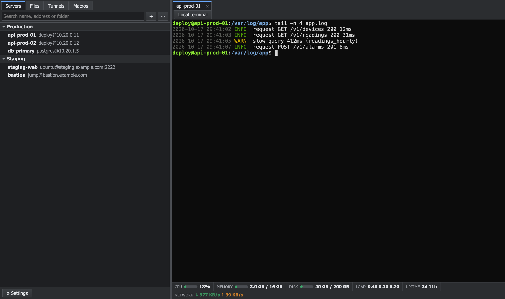
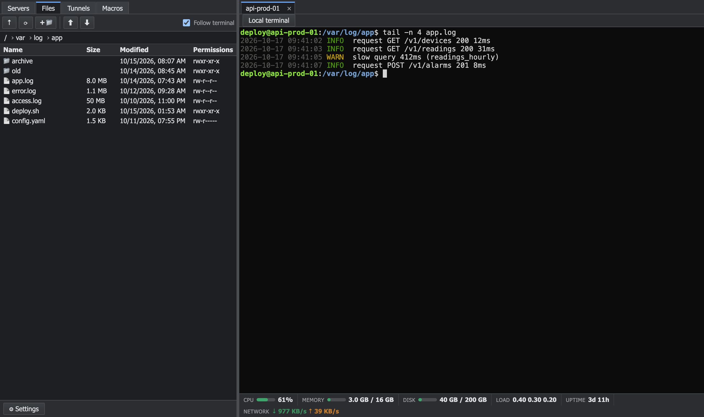

<p align="center"></p>

<h1 align="center">SSHFire</h1>

A fast, lightweight desktop SSH client in the spirit of MobaXterm: saved servers, tabbed terminals, an SFTP file panel that follows your shell, and live server metrics, all in one small app.

Built with Tauri 2, React and xterm.js on top of a Rust core ([`russh`](https://github.com/Eugeny/russh)).


## Features

**Connections**
- Saved server list with folders and search; double-click to connect
- Password, key file (including passphrase-protected keys), SSH agent and keyboard-interactive (two-factor) authentication
- Jump hosts (bastions), host key verification (trust on first use, refuses changed keys)
- Passwords and key passphrases live in the OS key store (macOS Keychain, Windows Credential Manager, Linux Secret Service), never in files
- Import hosts from `~/.ssh/config` (including `ProxyJump`), export and import the server list as JSON (passwords are never exported)
- Optional command to run on connect, color labels for servers (shown in the list and on tabs), local terminal tab

**Terminal**
- Tabs plus side-by-side, stacked and grid layouts, with keyboard shortcuts (macOS: ⌘T new local terminal, ⌘W close, ⌘1-9 jump, ⌘⇧[ ⌘⇧] cycle; Windows/Linux: Ctrl+Shift+T / Ctrl+Shift+W, Alt+1-9, Ctrl+Tab)
- Copy/paste, zoom, search, clickable links (Cmd/Ctrl + click, http/https only)
- MultiExec (type once, send to several tabs), macros you can write or record
- Live metrics bar: CPU, memory, disk, load, uptime, network (Linux servers)
- Record a session to a plain-text log file
- Color schemes: Dracula, Nord, Solarized Dark, Tokyo Night, Gruvbox

**Files**
- SFTP panel that follows the shell's working directory
- Copy, cut, paste, drag-and-drop move/copy, inline rename, upload/download with progress and cancel, drag files in from the OS
- Built-in text editor for remote files (Ctrl/Cmd+S saves), or open a file in your default editor and have it uploaded back on every save
- Change permissions (rwx boxes or octal), filter the listing by name

**Tunnels**
- Local (`-L`), SOCKS5 dynamic (`-D`) and remote (`-R`) port forwarding, saved per server

**Interface**
- Light and dark theme, English and Turkish, resizable sidebar and columns

## Screenshots

**Servers organised in folders, with a live metrics bar under the terminal**



**Side-by-side terminals**



## Platforms

macOS, Windows and Linux. Release builds for all three are produced by GitHub Actions.

## Install

Download the installer for your platform from the [latest release](https://github.com/aralozaltin/sshfire/releases/latest).

On first launch your system may ask you to confirm an app downloaded from the internet:

- **macOS:** open *System Settings → Privacy & Security* and choose *Open Anyway*, or run `xattr -dr com.apple.quarantine /Applications/SSHFire.app` once.
- **Windows:** in the SmartScreen dialog choose *More info → Run anyway*.

From then on SSHFire keeps itself up to date: it checks for new releases on startup (switch this off or check manually in *Settings*). Updates are downloaded over HTTPS and verified against a built-in public key before they are installed.

## Getting started

Requirements: Node.js, Rust (`rustup`) and the [Tauri prerequisites](https://tauri.app/start/prerequisites/) for your platform.

```bash
npm install            # .npmrc enables legacy-peer-deps
npm run tauri dev      # run in development
npm run tauri build    # production bundle
```

## Tests

```bash
cargo test --workspace             # Rust core and Tauri layer
npm test                           # interface tests (Vitest)
vcore/tests/docker/up.sh           # local OpenSSH test server on 127.0.0.1:2222
cargo test -p vcore -- --ignored   # tests that touch the real OS key store (manual)
```

The SSH, SFTP, tunnel and authentication integration tests run against a throwaway OpenSSH container and are skipped when it is not running. The test credentials in `vcore/tests/docker/` belong to that container only.

## Project layout

- `vcore/`: UI-independent Rust library (sessions, secrets, known hosts, SSH, SFTP, tunnels, metrics, `~/.ssh/config` parser)
- `src-tauri/`: Tauri commands, local terminal, transfer and streaming back-pressure
- `src/`: React interface

## License

[MIT](LICENSE)
